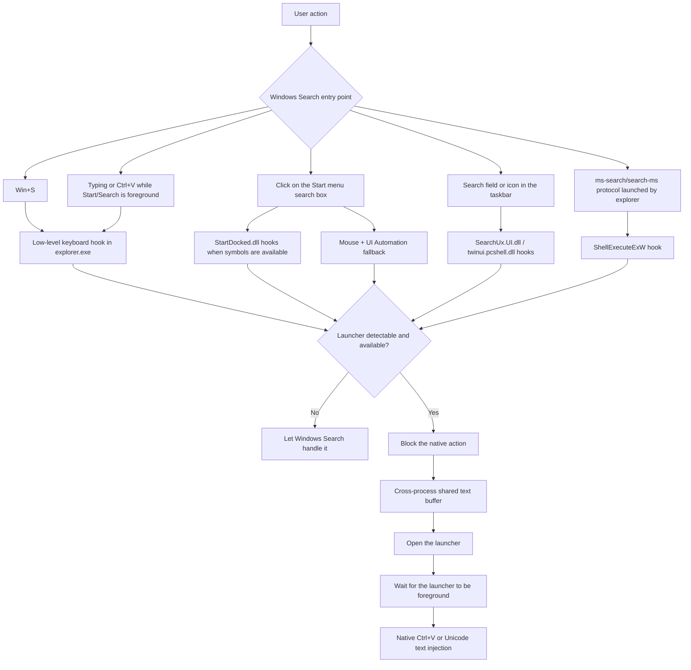
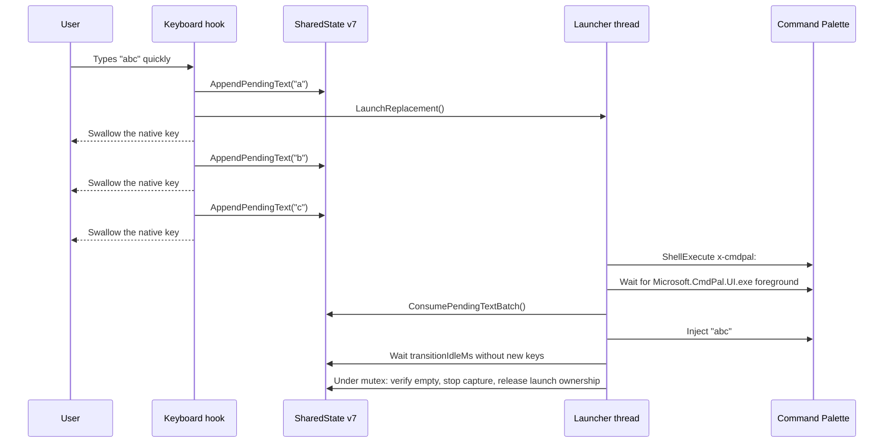
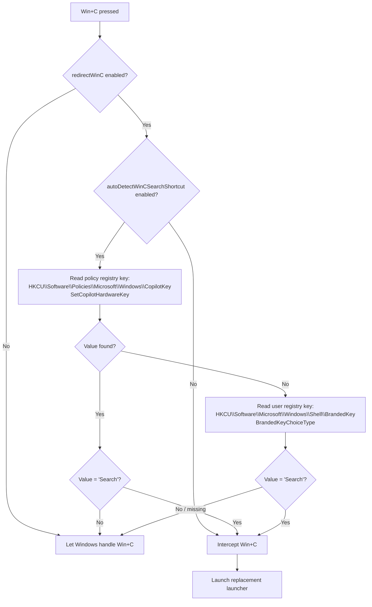
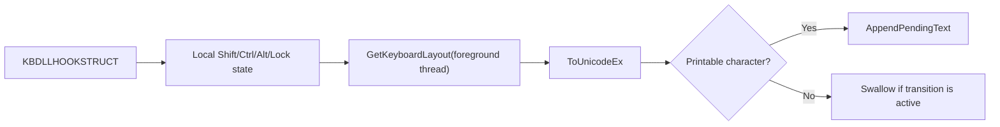
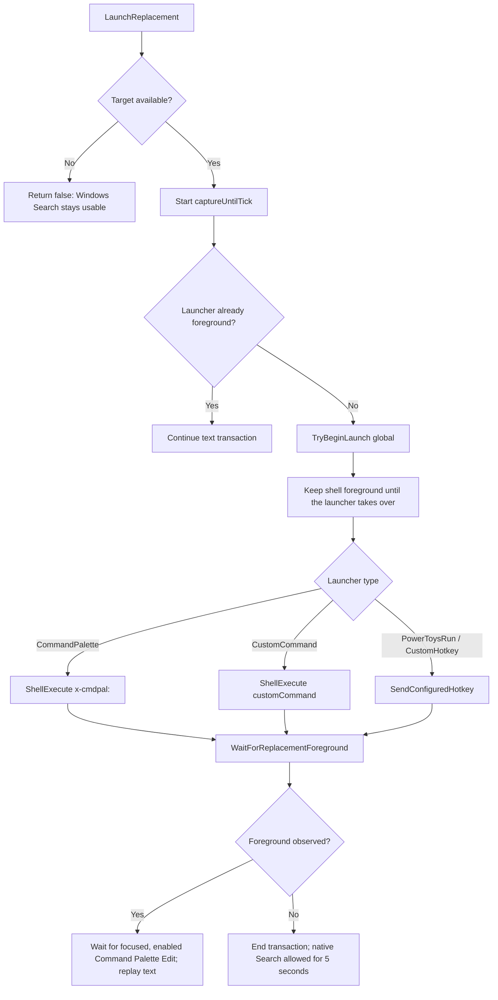
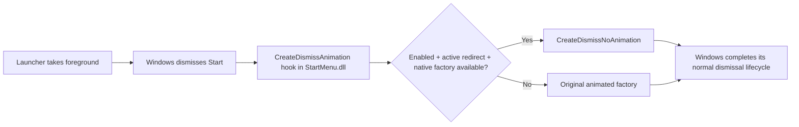

# Windows Search Redirector

> English version · [Version française](README.fr.md)

This project is a self-contained Windhawk mod that replaces the Windows Search entry points with an external launcher. The default target is PowerToys Command Palette via `x-cmdpal:`. The mod buffers text typed or pasted during activation and checks the destination before replaying it. See the limitations below: activation failure is not a lossless recovery path.

Current pre-release: [**1.0.4-dev**](https://github.com/Fefedu973/Windows-Search-Redirector/releases/tag/v1.0.4-dev). See the [release notes](docs/releases/1.0.4-dev.md) for changes and verification limits.

This version adds native animation-free Start dismissal on supported builds and optional Command Palette placement. See the [investigation and runtime evidence](docs/presentation-investigation-2026-10-11.md).

## Installation

1. Install [Windhawk](https://windhawk.net/).
2. Create a new local mod in Windhawk.
3. Replace its source with [`src/replace-windows-search.wh.cpp`](src/replace-windows-search.wh.cpp).
4. Compile the mod, review the settings, and enable it.

The default configuration targets PowerToys Command Palette. PowerToys Run, a custom hotkey, and a custom command or URI are also supported.

## Layout

| Path | Purpose |
| --- | --- |
| `src/replace-windows-search.wh.cpp` | Single source file for the Windhawk mod. |
| `tools/wh-tool.ps1` and `wh.cmd` | CLI toolchain to compile, install, reload and read Windhawk logs. |
| `tools/dbwin-listener.cpp` | Source for the `OutputDebugString` listener. |
| `tools/bin/dbwin-listener.exe` | Local binary of the log listener. |
| `tests/wh-test-input.cpp` | Test harness used to simulate Start/Search input. |
| `tests/bin/wh-test-input.exe` | Local binary of the test harness. |
| `tests/runtime-regression.cpp` | Desktop regressions, semantic Start search click and actual palette position checks. |
| `tests/palette-placement.cpp` | Standalone tests of the geometry used by the single-file mod. |
| `tests/record-start-dismiss.ps1`, `tests/analyze-start-dismiss.py` | Record a transition, track the Start border using actual frame timestamps and generate a contact sheet. |

## Overview



The mod is injected into three processes:

| Process | Responsibility |
| --- | --- |
| `explorer.exe` | Main coordination, global keyboard/mouse hooks, Search protocol hook, UIA fallback, `twinui.pcshell.dll` hooks when available. |
| `StartMenuExperienceHost.exe` | `StartDocked.dll` hooks for Start UI to Search transitions; optional native dismissal factory in the newer `StartMenu.dll`. |
| `SearchHost.exe` | `SearchUx.UI.dll` hooks for the taskbar/SearchHost paths. |

## Hook Matrix

| User path | Primary hook | Fallback | Behavior |
| --- | --- | --- | --- |
| `Win+S` | `WH_KEYBOARD_LL` | None | The `S` key is swallowed and the launcher is opened. |
| Typing in the open Start menu | `WH_KEYBOARD_LL` while Start/Search is foreground | Transactional capture window | Characters are buffered until the launcher is ready. |
| `Ctrl+V` in Start/Search | `WH_KEYBOARD_LL` + bounded clipboard read | Unicode injection when the clipboard was normalized | The native Windows Search paste is blocked. |
| Click on the Start search bar | XAML hooks in `StartDocked.dll` | `WH_MOUSE_LL` + semantic UI Automation | The click is swallowed if the launcher is available. |
| Open Start with its taskbar button or `Ctrl+Esc` | Low-level mouse/keyboard hooks | Short suppression window | Search side effects caused by opening Start are ignored without blocking the Start menu itself. |
| Taskbar Search | `SearchUx.UI.dll` | `twinui.pcshell.dll` depending on the Windows path | The native Search activation is canceled. |
| `ms-search:` / `search-ms:` protocols | `ShellExecuteExW` in explorer | No hook outside the injected processes | The query is extracted and the caller receives a synthesized success. |

Windows symbol hooks are inherently fragile: the PDBs change between builds. Hooks that depend on private symbols are therefore opportunistic, and the keyboard/UIA paths remain mandatory.

## Text Transaction



## Win+C Detection

Redirection of `Win+C` is conditional: the mod first checks whether `Win+C` is currently configured to open Windows Search, then decides whether to intercept it or leave the native Windows behavior intact.



The shared state uses:

| Element | Role |
| --- | --- |
| Mapping `Local\Windhawk.ReplaceWindowsSearchWithApp.SharedState.v7` | Stores pending text, launch owner PID, timestamps and failure cooldown. The `vN` suffix changes with the layout. A terminated owner can be recovered without taking over a live worker on a timer. |
| Mutex `Local\Windhawk.ReplaceWindowsSearchWithApp.SharedState.Mutex.v7` | Protects the buffer, capture decision and transaction completion across processes. |
| `initialized` field | Ensures only one process zero-initializes the shared memory at creation. |
| `launchInProgress` | Prevents multiple processes from opening the launcher concurrently. |
| `captureUntilTick` | Defines the period during which keys are swallowed. |
| `pendingTextCanPasteOriginal` | Allows a native `Ctrl+V` only when the clipboard text was not normalized. |

`SharedStateLock` instances used from low-level hooks have a short timeout (50 ms by default). The launcher thread uses a longer timeout (500 ms) so captured text is not silently dropped.

## Keyboard And Text

Capture respects the active keyboard layout: the hook keeps a local modifier state and uses `ToUnicodeEx` with the foreground thread's layout. The final injection uses `KEYEVENTF_UNICODE`, which avoids AZERTY/QWERTY mismatches when forwarding to Command Palette.

Replay submits an entire UTF-16 batch with one `SendInput`, not a timed loop per character. Key-up events paired with swallowed key-downs are swallowed too. External `VK_PACKET` Unicode input is decoded directly; only the mod's own marked events bypass capture unconditionally. Finishing a transaction and accepting a new character use the same mutex, so a late character cannot be appended after the worker has declared the buffer empty.



Clipboard content and protocol queries are normalized to a single-line query: line breaks and tabs become spaces, control characters are dropped, and the size is bounded before copy.

Known limit: composed dead keys can remain imperfect on certain layouts because the mod avoids mutating the global `ToUnicodeEx` keyboard state.

## Launcher Activation



For Command Palette, the primary path is `x-cmdpal:`. The `Win+Alt+Space` hotkey is never sent by default to avoid opening PowerToys Run instead. A hotkey is only used when `customHotkey` is explicitly configured or when the selected mode is `PowerToys Run` / `Custom hotkey`.

Availability requires a matching launcher window and a successful bounded `WM_NULL` responsiveness probe (40 ms, cached for 200 ms). `PowerToys.exe` alone is insufficient. A hidden/cloaked but responsive Command Palette is eligible to be summoned; it must be visible, uncloaked, foreground and have a focused enabled UI Automation Edit before text is replayed. The extra injection delay defaults to zero. Existing installations retain their explicit delay setting.

Foreground activation no longer attaches input queues, focuses a top-level HWND, flips topmost state, or sends Escape before launching. After a denied foreground request, a masked Alt sequence can unlock activation, but only with no Shift/Ctrl/Alt/Win held, to avoid triggering a keyboard-layout shortcut. A swallowed Win+S is masked before Windows-key release so it does not become a bare Win press.

If the launcher disappears or becomes unresponsive before admission, the original hook runs normally. If activation fails **after** admission, the current buffered query is discarded rather than sent to an unrelated application; subsequent requests pass through for five seconds. This is not automatic restoration of the first query.

In `Custom hotkey` mode, `customProcessName` is required to detect the foreground and forward text. In `Custom command` mode it is also required when the command is a URI or when the process name cannot be inferred from a `.exe`.

## Start Dismissal And Placement

On the newer Start menu, `StartMenu.dll` supplies both `AnimationProvider::CreateDismissAnimation()` and `CreateDismissNoAnimation()`. When `instantStartDismiss` is enabled and a shared launch transaction is active, the mod substitutes the second native factory for the first. Windows still owns deactivation, composition and completion callbacks. The mod does not forcibly hide the Start HWND, change system animation preferences or call a private Explorer presenter through an unverified object pointer. If either symbol is unavailable, ordinary dismissal is retained.



This removes the closing slide, not the time needed to summon the launcher. A local control recording showed a roughly 200 ms slide; the enabled recording showed Start stationary in one frame and absent in the next, 17 ms later. This is evidence for the tested build, not a promise of sub-frame timing or support on every Windows version.

Command Palette placement is opt-in. Choose any of the nine screen positions, custom percentages, or **Follow Start horizontally**. The latter reads the visible `SearchBoxToggleButton` bounds through UI Automation before activation, aligns the palette's center with that control, and retains its native vertical position within the work area. It does not use screen-coordinate guesses or the fullscreen Start host HWND. If Start is absent or its semantic control cannot be read, the palette is left alone.

Fixed/custom presets can use the launcher, source-window, pointer or primary monitor. Placement respects the work area, taskbar and DPI-scaled margin; custom percentages describe the available travel of the whole window. The mod moves only the verified, visible foreground Command Palette window, without activation, resizing or z-order changes. It does not reposition an already-foreground palette, PowerToys Run, custom launchers, or manual Command Palette invocations. Default placement performs no extra UIA lookup or move. A cross-monitor DPI change allows a bounded correction, not continuous enforcement against user dragging.

Late-loaded DLL hooks are applied from a watcher started in `Wh_ModAfterInit`. The watcher is joined in `Wh_ModBeforeUninit`, before Windhawk removes hooks. No hook operations are applied from `Wh_ModInit` or after the before-unload callback returns.

## Settings

| Setting | Default | UI type | Effect |
| --- | --- | --- | --- |
| `launcher` | `commandPalette` | Combobox | Choose Command Palette, PowerToys Run, custom hotkey or custom command. The legacy values `0`, `1`, `2`, `3` are still accepted. |
| `requireLauncherAvailable` | `true` | Toggle | Only redirect when the actual launcher has a responsive window. Otherwise preserve native Search. |
| `customProcessName` | empty | Text | Process names for availability/foreground checks, separated by `,` or `;`. |
| `customHotkey` | empty | Text | Optional hotkey, e.g. `win+alt+space`, `ctrl+space`, `alt+space`. |
| `customCommand` | empty | Text | Custom executable, command or URI. |
| `customCommandArgs` | empty | Text | Arguments for a custom executable. Ignored for URI commands. |
| `commandPalettePosition` | `default` | Combobox | Default, Follow Start horizontally, nine grid positions, or custom percentages. Only when the mod opens Command Palette. |
| `commandPaletteMonitor` | `launcher` | Combobox | PowerToys-selected monitor, source window, mouse pointer or primary monitor. Follow Start uses Start's monitor instead. |
| `commandPaletteMargin` | `16` | Number | Work-area edge margin in DPI-scaled pixels, clamped to 0-200. |
| `commandPaletteX` / `commandPaletteY` | `50` / `25` | Number | Custom mode: horizontal/vertical travel, clamped to 0-100 percent. |
| `instantStartDismiss` | `true` | Toggle | Use StartMenu.dll's native no-animation factory during redirection when available. Ordinary Start use remains unchanged outside a transaction. |
| `textCaptureDelayMs` | `0` | Number | Optional extra delay after input readiness. Clamped to 0-2000 ms. |
| `debounceMs` | `300` | Number | Global double-launch guard. Clamped to 0-5000 ms. |
| `transitionCaptureMs` | `3500` | Number | Maximum capture window during launcher activation. Clamped to 50-10000 ms. |
| `transitionIdleMs` | `80` | Number | Time without input before a transaction completes. Clamped to 0-1000 ms. |
| `redirectWinS` | `true` | Toggle | Redirect the `Win+S` shortcut. |
| `redirectWinQ` | `true` | Toggle | Redirect the `Win+Q` Search shortcut. |
| `redirectWinC` | `true` | Toggle | Redirect `Win+C` when it is configured to open Windows Search. |
| `autoDetectWinCSearchShortcut` | `true` | Toggle | Check `HKCU\Software\Microsoft\Windows\Shell\BrandedKey\BrandedKeyChoiceType` and only redirect `Win+C` when it is set to `Search`. Disable this to force `redirectWinC` manually. |
| `redirectStartMenuTyping` | `true` | Toggle | Redirect direct typing, paste and backspace while `StartMenuExperienceHost.exe` is foreground. |
| `redirectSearchHostTyping` | `true` | Toggle | Redirect direct typing, paste and backspace while `SearchHost.exe` is foreground. Disable this to keep only Start menu typing redirection. |
| `redirectStartMenuSearchBoxClick` | `true` | Toggle | Redirect clicks/taps on the Start menu search box, including UI Automation fallback. |
| `redirectStartMenuSearchTransitions` | `true` | Toggle | Redirect private StartDocked focus/open-search requests. |
| `redirectTaskbarSearch` | `true` | Toggle | Redirect taskbar Search button and SearchHost activation hooks. |
| `redirectUndockedSearch` | `true` | Toggle | Redirect twinui/undocked Windows Search activation hooks. |
| `redirectSearchProtocol` | `true` | Toggle | Redirect `ms-search:`, `search-ms:` and `ms-searchassistant:` launches. |
| `allowInjectedInput` | `true` | Toggle | Lets test tools generate synthetic keystrokes. |
| `log` | `false` | Toggle | Enable detailed debug logs (typed and pasted text are never logged). |

All settings are published through an atomic snapshot guarded by an `SRWLOCK`. Redirect toggles are also mirrored to atomic flags so disabled paths can pass through cheaply from low-level hooks. `Wh_ModSettingsChanged` rebuilds the full snapshot, which prevents `std::wstring` data races when settings change while hooks are active.

The redirect toggles enable or disable redirection layers, not necessarily the physical installation of hooks. Hooks may still be installed so settings can change at runtime, but disabled layers pass through to the original Windows behavior.

Some Windows Search entry points are covered by multiple fallback layers. To fully restore a native path, disable both the specific entry-point setting and broader fallback layers such as `redirectUndockedSearch` or `redirectSearchHostTyping` when applicable. `redirectSearchHostTyping` only controls text typed while `SearchHost.exe` is already foreground, and is independent from `redirectTaskbarSearch`.

`Win+C` auto-detection uses the Windows Copilot key/Win+C registry setting. `Win+Q` is a known Search shortcut and is controlled by its own toggle directly.

## Toolchain

From the repository root:

```powershell
.\wh.cmd status
.\wh.cmd build
.\wh.cmd install -EnableAfterBuild -DebugLogging
.\wh.cmd reload
.\wh.cmd logs -Tail 200
```

`OutputDebugString` listener:

```powershell
.\tools\bin\dbwin-listener.exe .\logs\replace-search.log 10000
```

Quick tests:

```powershell
.\tests\bin\wh-test-input.exe starttype AZERTY123
.\tests\bin\wh-test-input.exe startpaste "text from clipboard"
.\tests\bin\wh-test-input.exe startclicksearch
.\tests\bin\wh-test-input.exe wins
.\tests\bin\wh-test-input.exe ctrlesc
.\tests\bin\wh-test-input.exe startbutton
```

## Changelog

### 1.0.4-dev

- Optional Command Palette placement, including semantic horizontal alignment with Start.
- Native no-animation Start dismissal on supported `StartMenu.dll` builds.
- Correct lifecycle for late hook installation and watcher shutdown.
- 21 geometry assertions, 11 desktop regressions, six actual placement presets and frame-by-frame control/comparison recordings. See [evidence and remaining limits](docs/presentation-investigation-2026-10-11.md).

### 1.0.3-dev

- Responsive-window availability checks and shared activation-failure cooldown.
- Foreground/input-readiness checks without input-queue attachment or premature Escape.
- Atomic capture completion, batched Unicode replay and paired key-up suppression.
- Zero default extra injection delay; explicit existing settings are preserved.
- Real desktop regression suite: `tests/run-runtime-regression.ps1`. Requires an idle desktop; do not use the mouse or keyboard while it runs. No command is executed and the clipboard is untouched.
- Investigation and verification details: [2026-10-11 report](docs/runtime-investigation-2026-10-11.md).

### 1.0.2

- Ignore transient Search activations caused by opening Start from the taskbar.
- Apply the same protection to `Ctrl+Esc`.
- Extend the input harness with `ctrlesc` and `startbutton` regression checks.

## Maintenance

| Invariant | Reason |
| --- | --- |
| The mod stays in a single Windhawk source file. | Windhawk distributes mods as a single self-contained C++ file. |
| Settings are always read through `GetSettingsSnapshot()`. | Avoids `std::wstring` data races when settings change while hooks run. |
| The Command Palette hotkey is not sent by default. | `x-cmdpal:` is the primary path and avoids opening PowerToys Run. |
| `LaunchReplacement()` returns `true` when a recent transaction is already in progress. | Prevents Windows Search from leaking through between rapid keystrokes. |
| `g_unloading` is set under `g_launchTrackingLock` in `Wh_ModUninit()`. | Stops `LaunchReplacement` and `RequestReplacement` from spawning a thread during teardown, even with concurrent activation. |
| Bump the `vN` suffix of the shared mapping/mutex when `SharedState`'s layout changes. | Different mod versions in concurrently injected processes must not see incompatible layouts. |
| Logs never contain captured text. | The mod touches the keyboard and clipboard, so logs must remain non-sensitive. |
| Launch threads are awaited on unload. | Avoids use-after-free on the shared state or module code. |
